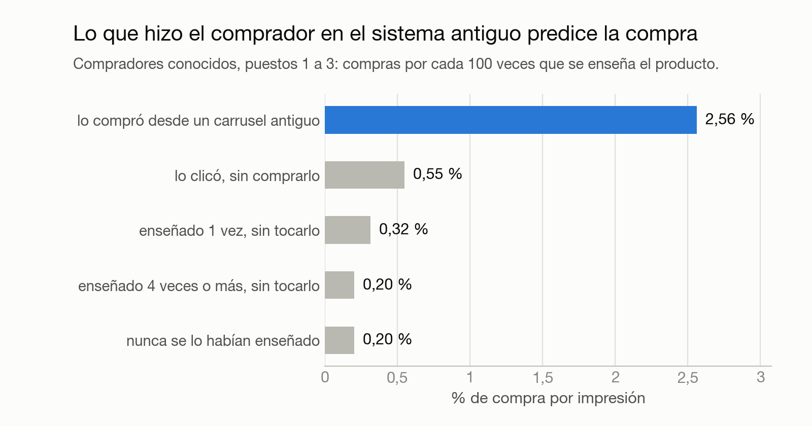
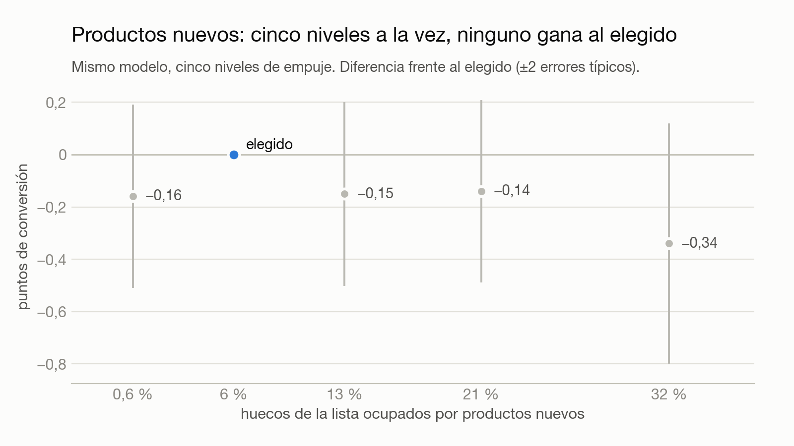
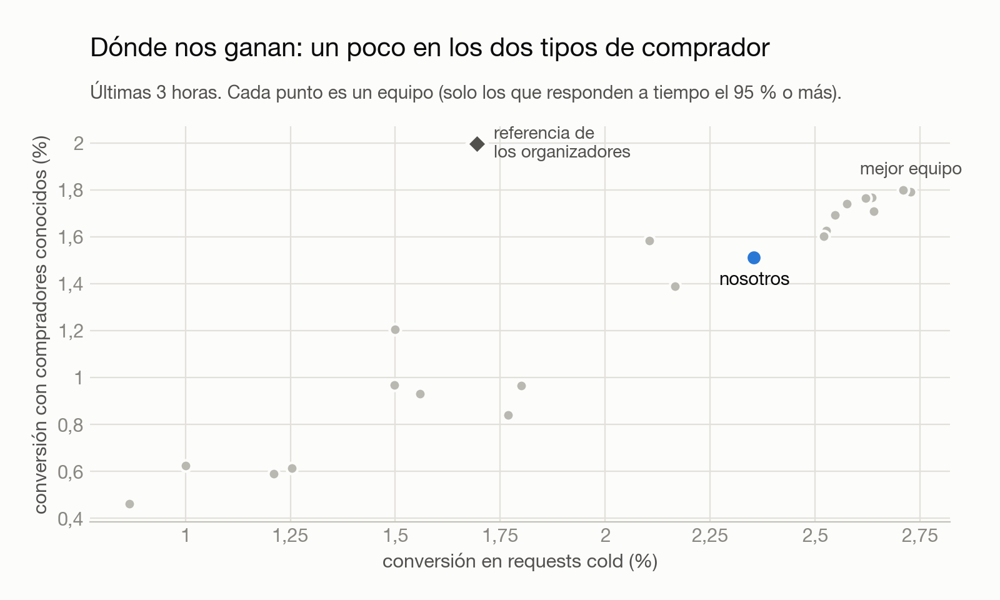
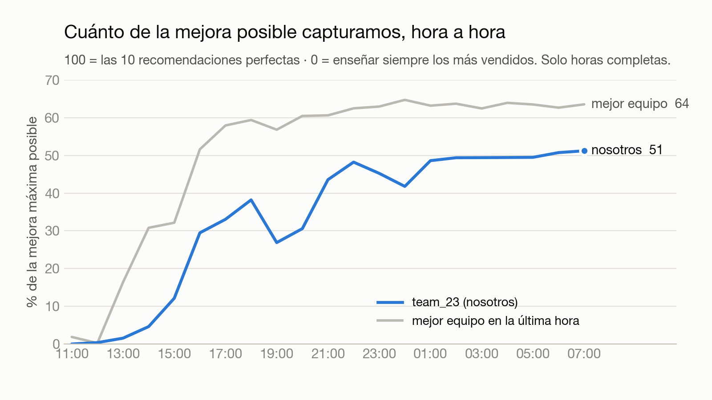

# Guion de la presentación al jurado (team_23)

_Generado con los números actuales. 9 diapositivas, unos 6 minutos. En **negrita** lo que hay en pantalla; en cursiva, lo que se dice._

## 1. team_23 · Un recomendador que aprende mientras atiende

- **Capturamos el 51 % de la mejora máxima posible (0 = los más vendidos, 100 = la lista perfecta).**
- **Respondemos en 1 segundo de mediana, con el límite en 3.**
- **De la versión del sábado a la final: +0,83 puntos de conversión (±0,49), medidos en vivo.**

_Somos cuatro y empezamos de cero el sábado por la mañana. Nuestra idea ha sido sencilla: un modelo que se pueda explicar, y que cada cambio se gane su sitio con datos en vivo y con su margen de error._

## 2. Cómo funciona: una request, 10 productos, 1 milisegundo de cálculo

- **Memoria de cada comprador: visto, carrito y comprado (60 días + hoy).**
- **En cada request se puntúan los ~5.400 productos: señales × pesos.**
- **Lectura, cálculo y envío en hilos separados: de 1,4 a 1,0 s de mediana.**
- **Cada despliegue pasa una prueba con requests reales y tiene vuelta atrás.**

_La fiabilidad va primero: si no respondes a tiempo, da igual lo bueno que sea el modelo. Lo ya comprado y lo agotado se quitan de la lista. Tuvimos tres paradas el sábado por desplegar a mano; de ahí salió el despliegue con comprobación previa y vuelta atrás con un comando._

## 3. El modelo, en ideas que se pueden leer

- **Lo que el comprador ya hizo: su carrito sube; lo que ya compró, fuera (en vivo no se recompra).**
- **Lo que acaba de ver en esta sesión.**
- **Parecido entre productos: "quien metió X en el carrito o lo compró, también Y".**
- **Lo bueno que es el producto: carritos por cada visita, no ventas totales.**
- **Lo que cada comprador hizo en el sistema antiguo: si compró un producto desde un carrusel, lo compra 13 veces más que uno que nunca vio.**
- **Pesos distintos para compradores nuevos y conocidos.**

_Es una suma de señales con pesos. Lo elegimos así a propósito: se entrena en segundos, responde en un milisegundo y cuando algo va mal podemos mirar qué peso lo causa. A los compradores nuevos les mueve lo que convence a todos; a los conocidos, su carrito y su historial. La última señal salió de una tabla que casi nadie mira: los carruseles del sistema antiguo guardan qué enseñó, qué se clicó y qué se compró, comprador a comprador._

## 4. Aprender del stream: reentrenar con nuestras propias respuestas

- **Cada minuto: eventos nuevos a la memoria de cada comprador, tasas de cada producto y productos nuevos.**
- **Cada pocas horas: los pesos se reajustan con lo que de verdad se compró en nuestras listas.**
- **Cada versión nueva entra con parte del tráfico y compite con la campeona.**
- **Cuatro pasos, +0,83 puntos en total (±0,49). Dos son claros por sí solos; los otros quedan dentro del margen.**

_El histórico no se comporta igual que el vivo, así que sus pesos solo son el punto de partida. Para reentrenar reproducimos el día en orden, cada request con lo que se sabía en ese momento, para no hacer trampa. Lo que más nos ha dado es aprender de las listas que nosotros mismos enseñamos. El último paso parece pequeño porque solo cambia las listas de los compradores conocidos; con ellos la mejora es clara: +0,14 puntos en casi cuatro horas de prueba, la más larga de la noche._

## 5. Decidir con datos: antes de medir, medir la regla

- **Comparamos versiones con la conversión esperada del leaderboard: mucho menos ruido que contar compras.**
- **Medimos ese ruido: 5,9 puntos por request. Dos versiones idénticas difieren 0,3 puntos con 600 requests.**
- **Regla: promocionar solo con 2 errores típicos y 3.000 requests.**
- **Nos corregimos: empezamos suponiendo un ruido de 4 y varias "victorias" no lo eran.**

_A las cinco de la mañana medimos bien el ruido, con 210 comparaciones entre versiones que corrieron a la vez, y salió un 50 % mayor del que usábamos. Releímos la noche entera: las mejoras grandes siguen en pie y otras decisiones, como cuántos productos nuevos enseñar, quedaron en "no se puede saber con estos datos". Preferimos contarlo así. También perdieron en vivo ideas que ganaban con datos guardados: poner todos los carritos primero, empujar las rebajas, un modelo de árboles._

## 6. Lo que aprendimos de esta tienda

- **Los 50 productos más comprados se llevan el 65 % de las compras del carrusel; los 200, el 93 %.**
- **No son los que más se venden, sino los que más convencen: carritos por visita.**
- **Con compradores conocidos, 7 de cada 10 compras ya estaban en su carrito.**
- **El histórico engaña: allí el 64 % de las compras del carrusel eran recompras; en vivo no se recompra.**

_Esto cambió el modelo: dejamos de medir popularidad por volumen y pasamos a medirla por lo que convence un producto. Lo de las recompras lo vimos gracias a la columna propensity: el sistema antiguo elegía solo por popularidad, sin mirar al comprador, así que sus carruseles son un experimento limpio. También comprobamos lo que no hay: ni modas por horas, ni efecto de las rebajas, ni un nivel de precio propio de cada comprador. Y que toda compra pasa por un clic._

## 7. Cómo usamos RawTree

- **Requests: dos lectores en paralelo cada 0,2 s; respuestas por lotes en hilos aparte.**
- **Estado en SQL, sin ETL: stock cada 2 s; catálogo, popularidad y tasas por producto cada minuto.**
- **Memoria de compradores y parecido entre productos: agregaciones y un self-join sobre 12 millones de eventos.**
- **Historial de los 2 millones de carruseles antiguos: 10 millones de parejas comprador-producto agregadas en SQL.**
- **Entrenar y medir: feedback unido a requests y eventos en orden temporal; conversión esperada por versión.**

_Todo el cálculo pesado lo hace RawTree con SQL; en el portátil solo queda multiplicar señales por pesos. Aprendimos a no lanzar descargas grandes mientras producción corre: las bajamos en trozos pequeños, de uno en uno._

## 8. Resultado: dónde estamos y por qué

- **De 38 % de la mejora posible a las 18:00 a 51 % de madrugada.**
- **Puesto 12 de 42. Los 9 equipos de delante nos sacan unas décimas en los dos frentes: cold 2,35 % frente a 2,62 %; conocidos 1,51 % frente a 1,74 %.**
- **A la referencia de los organizadores la ganamos en cold (2,35 % frente a 1,69 %) y perdemos con conocidos (1,51 % frente a 2,00 %).**
- **Versión final: v33-user-history.**

_Cada décima que tenemos está medida frente a la versión anterior, con su margen, y sabemos de dónde viene. También sabemos lo que no sabemos: probamos una docena de señales más esta madrugada y ninguna movió la aguja, así que lo que les falta a nuestras listas no está en las señales que tenemos._

## 9. Lo que salió mal y lo que haríamos distinto

- **Tres paradas por desplegar a mano y tres cortes de red: de ahí salieron el despliegue con vuelta atrás y la alarma de conexión.**
- **Medimos tarde el ruido de nuestra propia regla: varias decisiones de la noche se tomaron con menos certeza de la que creíamos.**
- **Con más tiempo: evaluar versiones sin gastar tráfico con la columna propensity, y un modelo en dos pasos (clic y compra).**

_Los dos bajones de la curva son las paradas del sábado por la tarde y los cortes de red de medianoche. Si empezáramos hoy, lo primero sería la herramienta de medida, y lo segundo aprovechar que el sistema antiguo sorteaba por popularidad para probar ideas con el histórico antes de gastar tráfico real._
