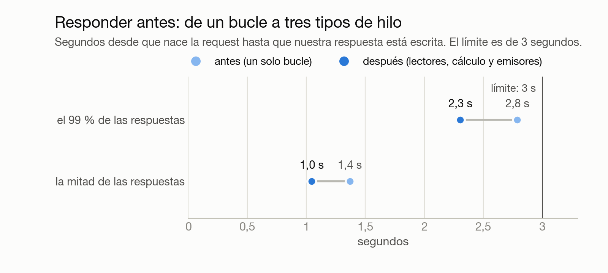
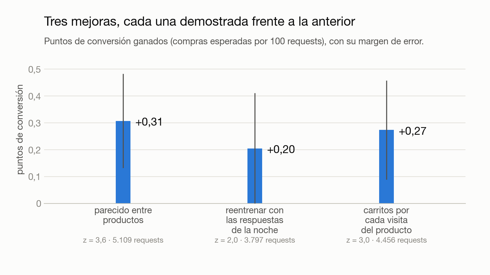
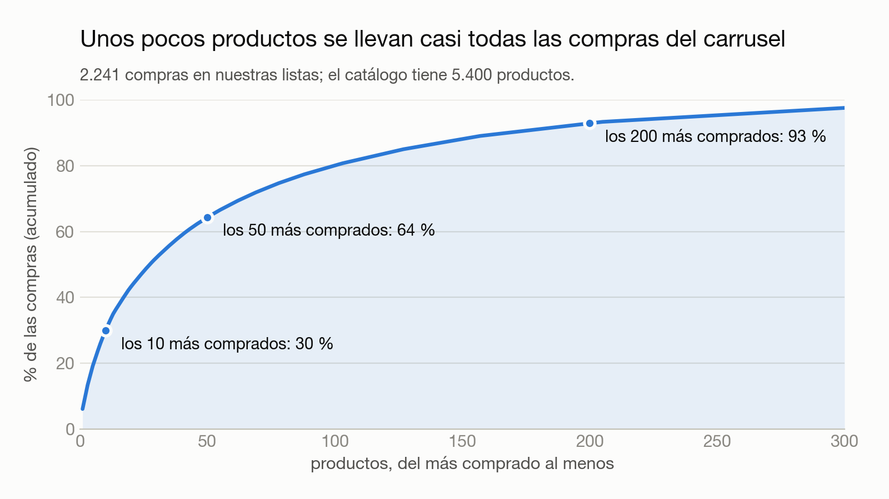

# Guion de la presentación al jurado (team_23)

_Generado con los números actuales. 8 diapositivas, unos 5 minutos. En **negrita** lo que hay en pantalla; en cursiva, lo que se dice._

## 1. team_23 · Un recomendador que aprende mientras atiende

- **Capturamos el 49 % de la mejora máxima posible (0 = los más vendidos, 100 = la lista perfecta).**
- **Respondemos en 1 segundo de mediana, con el límite en 3.**
- **Tres mejoras seguidas demostradas en vivo durante la noche: +0,79 puntos de conversión en total.**

_Somos cuatro y empezamos de cero el sábado por la mañana. Nuestra idea ha sido sencilla: un modelo que se pueda explicar, y que cada cambio se gane su sitio con datos en vivo._

## 2. Cómo funciona: una request, 10 productos, 1 milisegundo de cálculo

- **Memoria de cada comprador: visto, carrito y comprado (60 días + hoy).**
- **En cada request se puntúan los ~5.400 productos: señales × pesos.**
- **Lectura, cálculo y envío en hilos separados: de 1,4 a 1,0 s de mediana.**
- **Cada despliegue pasa una prueba con requests reales y tiene vuelta atrás.**

_La fiabilidad va primero: si no respondes a tiempo, da igual lo bueno que sea el modelo. Lo ya comprado y lo agotado se quitan de la lista. Tuvimos tres paradas el sábado por desplegar a mano; de ahí salió el despliegue con comprobación previa y vuelta atrás con un comando._

## 3. El modelo, en cuatro ideas que se pueden leer

- **Lo que el comprador ya hizo: lo que tiene en el carrito sube; lo que ya compró, fuera (en vivo no se recompra).**
- **Lo que acaba de ver en esta sesión.**
- **Parecido entre productos: "quien metió X en el carrito o lo compró, también Y".**
- **Lo bueno que es el producto: carritos por cada visita, no ventas totales.**
- **Pesos distintos para compradores nuevos y conocidos: a los nuevos les mueve lo que convence a todos; a los conocidos, su carrito y su historial.**

_Es una suma de señales con pesos. Lo elegimos así a propósito: se entrena en segundos, responde en un milisegundo y cuando algo va mal podemos mirar qué peso lo causa._

## 4. Aprender del stream: reentrenar con nuestras propias respuestas

- **Cada pocas horas se reajustan los pesos con lo que de verdad se compró.**
- **Cada versión nueva entra con parte del tráfico y compite con la campeona.**
- **Tres pasos seguidos: +0,31, +0,20 y +0,27 puntos de conversión.**

_El histórico no se comporta igual que el vivo, así que sus pesos solo son el punto de partida. Para reentrenar reproducimos el día en orden, cada request con lo que se sabía en ese momento, para no hacer trampa. Lo que más nos ha dado es aprender de las listas que nosotros mismos enseñamos._

## 5. Decidir con datos: lo que parecía buena idea y no lo era

- **Dos versiones idénticas pueden diferir 0,3 puntos con 600 requests.**
- **Regla: no decidir con menos de 3.000 requests ni de 2 errores típicos.**
- **Productos nuevos: ni sin empujón ni con más. Cinco niveles a la vez.**
- **Más de 25 versiones en un día; cada retirada, con su número.**

_Nos equivocamos varias veces, y lo interesante es cómo lo supimos: por la conversión esperada del leaderboard por versión, que tiene mucho menos ruido que contar compras. Perdieron en vivo ideas que ganaban en pruebas con datos guardados: poner todos los carritos primero, empujar las rebajas, un modelo de árboles. Llegamos a quitar el empujón a los productos nuevos por un análisis con pocas compras; la prueba en vivo dijo lo contrario en media hora._

## 6. Lo que aprendimos de esta tienda

- **Los 50 productos más comprados se llevan el 64 % de las compras del carrusel; los 200, el 93 %.**
- **No son los que más se venden, sino los que más convencen: carritos por visita.**
- **Con compradores conocidos, 7 de cada 10 compras ya estaban en su carrito.**

_Esto cambió el modelo: dejamos de medir popularidad por volumen y pasamos a medirla por lo que convence un producto. Fue la última gran mejora de la noche. También comprobamos lo que no hay: ni modas por horas ni efecto de las rebajas en el carrusel._

## 7. Cómo usamos RawTree

- **Requests: dos lectores en paralelo cada 0,2 s; respuestas por lotes en hilos aparte.**
- **Estado en SQL, sin ETL: stock cada 2 s; catálogo, popularidad y tasas por producto cada minuto (una fila por producto).**
- **Memoria de compradores y tabla de parecidos entre productos con agregaciones y un self-join sobre 12 millones de eventos.**
- **Entrenamiento: feedback unido a requests y a eventos, reproducido en orden temporal.**
- **Medida: la conversión esperada por versión del leaderboard, por tramos entre despliegues.**

_Todo el cálculo pesado lo hace RawTree con SQL; en el portátil solo queda multiplicar señales por pesos. Aprendimos a no lanzar descargas grandes mientras producción corre._

## 8. Resultado, y lo que haríamos distinto

- **De 38 % de la mejora posible a las 18:00 a 49 % de madrugada.**
- **Lo que salió mal: paradas por desplegar a mano y cortes de red. De ahí salieron el despliegue con vuelta atrás y la alarma de conexión.**
- **Con más tiempo: compradores conocidos, y precio según dispositivo y región.**
- **Versión final: v24-rate.**

_Cada décima que tenemos está medida frente a la versión anterior y sabemos de dónde viene. Eso es lo que nos llevamos._
